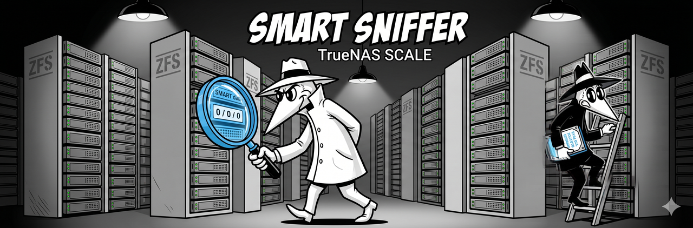

<p align="center">
  
</p>

# TrueNAS SCALE

TrueNAS SCALE is a Debian-based NAS OS built around ZFS. SMART Sniffer runs on it natively: drive health, ZFS pool health and pool usage all work with no extra packages.

## What's different about TrueNAS SCALE

1. **Drives are visible as they are.** TrueNAS runs its controllers in HBA (IT) mode, so each physical drive reaches the OS on its own and `smartctl --scan` finds them. smartmontools ships in the base image.

2. **ZFS is read the ZFS way.** Pool health comes from `zpool status`, and disk usage comes from `zfs list`, so a pool shows its real usage rather than the near-zero that a plain filesystem check reports on a pool root. The agent finds both tools on its own.

3. **The system dataset is read-only, and apt is locked.** Do not install packages with apt on TrueNAS; it is turned off by design and nothing in this guide needs it. The installer detects TrueNAS and installs the agent to a writable location (see Step 1).

## Step 1: Install the agent

```bash
curl -sSL https://raw.githubusercontent.com/DAB-LABS/smart-sniffer/main/install.sh | sudo bash
```

On TrueNAS the installer uses `/root/smartha-agent`. That works, but `/root` does not survive a major TrueNAS upgrade. To keep the agent across upgrades, install it onto a pool dataset instead:

```bash
curl -sSL https://raw.githubusercontent.com/DAB-LABS/smart-sniffer/main/install.sh | sudo bash -s -- --install-dir=/mnt/tank/apps/smartha-agent
```

Replace `tank/apps` with a pool and dataset of your own. During network interface selection, pick your management interface (the one with your LAN IP).

Verify:

```bash
sudo systemctl status smartha-agent
curl http://localhost:9099/api/health
```

## Step 2: Add the integration to Home Assistant

If Home Assistant runs on a separate machine or VM:

1. **HACS** > search for **SMART Sniffer** > Download
2. Restart Home Assistant
3. Home Assistant discovers the agent over mDNS. If it does not, add it from the SMART Sniffer Control Center in the sidebar (+ > Network), or set it up by hand with the TrueNAS IP and port 9099

If Home Assistant runs as a VM on TrueNAS SCALE, see the [Virtual Machines guide](virtual-machines.md). The same pattern applies: the agent on the host, the integration in the VM.

## ZFS and SMART: how they fit together

ZFS has its own health checks (`zpool status`, scrubs, checksums). SMART Sniffer does not replace them; it adds to them. ZFS catches errors at the data level: bad checksums and failed reads. SMART watches the drive's own health indicators (reallocated and pending sectors, wear, temperature), which often show up before ZFS sees an error.

The agent also reports what ZFS says. Each pool appears in Home Assistant as its own device, named for the host (for example "truenas ZFS pool tank"), with its state, error counts and last scrub. You get a notification when a pool degrades or disappears, and new pools appear without a reload. In the Control Center each pool has its own card next to the drives. Nothing to configure. To turn pool health off, set `zfs_pool_status: false` in the agent's config.

SAS drives, and any drive read over plain SCSI, have no Device Statistics log, so they get no Data Written sensor. SATA drives behind the HBA get one as long as smartctl reads them as ATA.

## Drive passthrough vs. RAID

Most TrueNAS systems run their SATA/SAS controllers in HBA (IT) mode, or use HBA cards. That passes each drive through to the OS, which is what SMART Sniffer needs. No special configuration required.

If you run a hardware RAID controller in RAID mode (uncommon on TrueNAS), see the [NAS & RAID Setup](../../README.md#nas--raid-setup) section for `device_overrides`.

## Troubleshooting

### The agent is gone after a TrueNAS upgrade

A major upgrade replaces `/root`. Run the installer again with `--install-dir` on a pool dataset (Step 1) so the next upgrade keeps it.

### Pool usage looks wrong

Pool usage comes from `zfs list`. Check it on the host with `zfs list -o name,used,avail` and compare. If the numbers match there but not in Home Assistant, update the agent by running the installer again.

### Home Assistant can't discover the agent

Same networking basics as any other setup. If TrueNAS and Home Assistant are on different VLANs, mDNS won't cross between them. Add the agent by hand with the TrueNAS IP and port 9099.

## Example config

```yaml
port: 9099
scan_interval: 120
```

TrueNAS SCALE usually needs no `device_overrides`, since the HBA presents the drives directly.

## Running in Docker instead

The native install above is the supported path. If you would rather keep the agent in a container, TrueNAS SCALE's Apps screen can run a custom app from a compose file. See the [Docker guide](docker.md) for what the container needs.

TrueNAS specifics:

- Nothing gets written to the system dataset, so TrueNAS upgrades cannot remove it.
- Drives in a ZFS pool can still be passed through as devices for SMART reads. The pool is unaffected.
- For disk usage, mount the host root read-only and set `mount_prefix`. The agent then reports pool usage the same way the native install does.

**Not yet verified on TrueNAS SCALE.** If you run it this way, please tell us what worked.

## Related

- [Proxmox guide](proxmox.md): if you run Home Assistant as a VM on TrueNAS, similar network considerations apply
- [Platform Install Paths](../platform-install-paths.md): install locations on different platforms
- [Main README: NAS & RAID Setup](../../README.md#nas--raid-setup): quick reference
